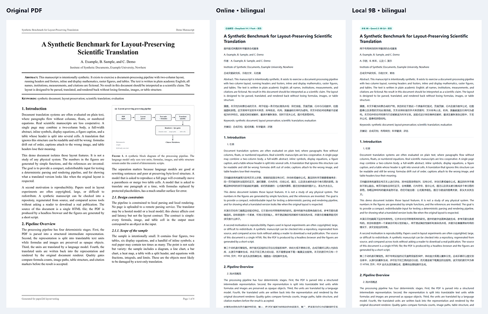

# 双栏合成示例论文

**本目录所有内容均为虚构。** 作者、单位、测量值和参考文献都是为了测试版式编造的，
不描述任何真实研究。

这份 4 页示例用来展示 `paper2zh` 处理复杂版式的能力：

- A4 双栏正文，通栏标题和摘要；
- 每页独立的页眉、页脚和页码；
- 6 个行间公式（分数、积分、极限、范数）；
- 4 张位图：框图、折线图、柱状图、热力图；
- 2 张带拆分表头的表格；
- 行内数学符号；
- 在线版和本地 9B 版都保留双语对照（`bilingual.md`）。

## 文件说明

| 文件 | 用途 |
|---|---|
| `source.html` | 论文的 HTML 源文件：A4 页面、CSS 双栏、MathML 公式，插图用 PNG |
| `make_figures.py` | 用 Pillow 生成四张插图 |
| `demo-paper.pdf` | 生成出来的 4 页 PDF |
| `preview-source.png` | PDF 第 1 页的截图 |
| `preview-online.png` | 在线模型 `bilingual.md` 的渲染截图 |
| `preview-local.png` | 本地 9B `bilingual.md` 的渲染截图 |
| `preview-comparison.png` | 原 PDF / 在线 / 本地 三列对比 |
| `preview-detail.png` | 插图和公式的放大细节对比 |
| `翻译结果/demo-paper/bilingual.md` | 在线模型输出的中英对照 |
| `翻译结果/demo-paper-local/bilingual.md` | 本地 Qwen3.5-9B Q4 输出的中英对照 |

两份译文都通过了公式、图片、表格、引用、语言五项质检。

- 在线版：77 段一次收齐，无退回；
- 本地版：首轮收下 75 段、退回 2 段，原因是 9B 把 Unicode 数学符号改成了 `$...$`，
  手工补交后同样通过。

## 效果

整体对比（左：原 PDF；中：在线模型；右：本地 9B）：



插图和公式放大：


## 怎么复现

```powershell
# 1. 生成四张插图
python make_figures.py

# 2. 用 Edge 把 HTML 打成 PDF（不需要 LaTeX）
& "C:\Program Files (x86)\Microsoft\Edge\Application\msedge.exe" `
  --headless=new --disable-gpu --no-pdf-header-footer `
  --print-to-pdf="demo-paper.pdf" `
  "file:///C:/path/to/samples/demo-paper/source.html"

# 3. 跑 paper2zh，翻译在线版
paper2zh.cmd prepare "demo-paper.pdf"
paper2zh.cmd next --agent --workdir "<产物目录>"
# ... 按批提交译文 ...
paper2zh.cmd finish --workdir "<产物目录>"

# 4. 本地 9B 对照（LM Studio 里先加载 qwen/qwen3.5-9b）
paper2zh.cmd local --workdir "<本地副本>" --model "qwen/qwen3.5-9b" --limit 100
paper2zh.cmd finish --workdir "<本地副本>"
```

截图用的预览 HTML 由 `make_preview.py` 从 `bilingual.md` 生成，
使用 `latex2mathml` + `markdown-it`，不依赖外部 CDN。

## 说明

- PDF 是 HTML 经 Chromium 打印生成的，不是 LaTeX；这样不用装 TeX 也能复现。
- 双栏版式拆成了独立的页面容器，所以每一页都能带自己的页眉页脚。
- 示例刻意做得小，它只是版式冒烟测试，不是评测基准集。
- 生成于 2026-11-19，使用 `paper2zh` 1.2.x。
