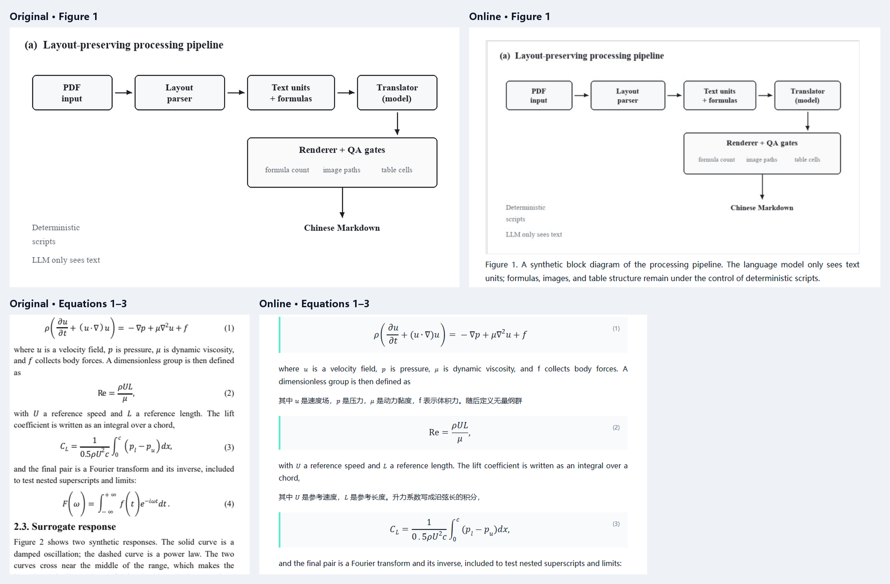

# Synthetic two-column demo paper

**All content in this folder is fictional.** The authors, affiliations, numbers, and
references were invented for layout testing. Nothing here describes a real study.

This sample exists to show how `paper2zh` handles a document with:

- A4, two-column body with a full-width title/abstract;
- running headers and footers, page numbers;
- six display equations (fractions, integrals, limits, norms);
- four raster figures (diagram, line chart, bar chart, heat map);
- two tables with split headers;
- six display equations and inline symbols.

## Files

| File | Purpose |
|---|---|
| `source.html` | Source of the paper. A4 pages, CSS columns, MathML, inline SVG is not used (figures are PNG). |
| `make_figures.py` | Generates the four PNG figures with Pillow. |
| `demo-paper.pdf` | The generated 4-page PDF. |
| `preview-source.png` | Page 1 of the PDF, rendered to PNG. |
| `preview-online.png` | `bilingual.md` from the online model, rendered to HTML and screenshotted. |
| `preview-local.png` | `bilingual.md` from the local 9B model, same treatment. |
| `preview-comparison.png` | Three-column comparison: original / online / local. |
| `preview-detail.png` | Large figure/formula detail: original vs bilingual output. |
| `翻译结果/demo-paper/bilingual.md` | Bilingual output from the online model. |
| `翻译结果/demo-paper-local/bilingual.md` | Bilingual output from local Qwen3.5-9B Q4. |

Both runs passed the same five quality gates: formula, image, table, citation, language.
The local run needed two manual re-submissions because the model turned Unicode math
symbols into `$...$`; after that it also passed.

## Preview




## Regenerate

```powershell
# 1. figures
python make_figures.py

# 2. PDF (Edge is available on Windows)
& "C:\Program Files (x86)\Microsoft\Edge\Application\msedge.exe" `
  --headless=new --disable-gpu --no-pdf-header-footer `
  --print-to-pdf="demo-paper.pdf" `
  "file:///C:/path/to/samples/demo-paper/source.html"

# 3. translate
paper2zh.cmd prepare "demo-paper.pdf"
paper2zh.cmd next --agent --workdir "<产物目录>"
# ... apply batches ...
paper2zh.cmd finish --workdir "<产物目录>"

# 4. local comparison (LM Studio loaded with qwen/qwen3.5-9b)
paper2zh.cmd local --workdir "<本地副本>" --model "qwen/qwen3.5-9b" --limit 100
paper2zh.cmd finish --workdir "<本地副本>"
```

The preview HTML used for the screenshots is generated from `bilingual.md` by
`make_preview.py` (latex2mathml + markdown-it, no CDN).

## Notes

- The PDF is generated from HTML with Chromium print-to-pdf, not LaTeX. This keeps the
  sample reproducible without a TeX installation.
- The two-column layout is split into explicit page containers so each page can carry its
  own header and footer.
- The sample is intentionally small. It is a layout smoke test, not a benchmark suite.
- Generated 2026-11-19 with `paper2zh v1.2.0`; not uploaded yet.
