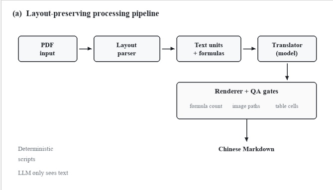
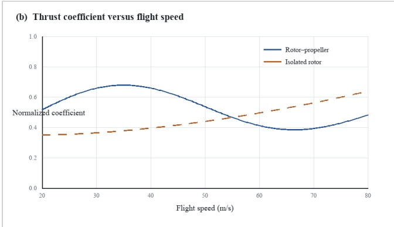
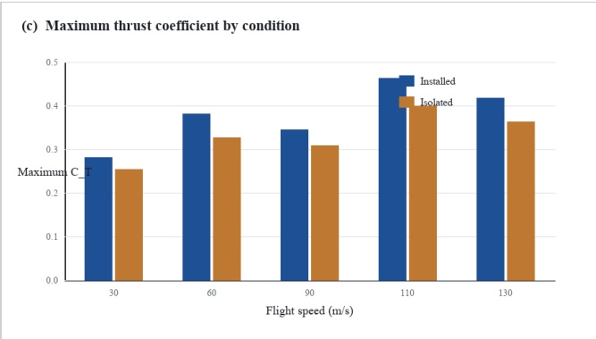
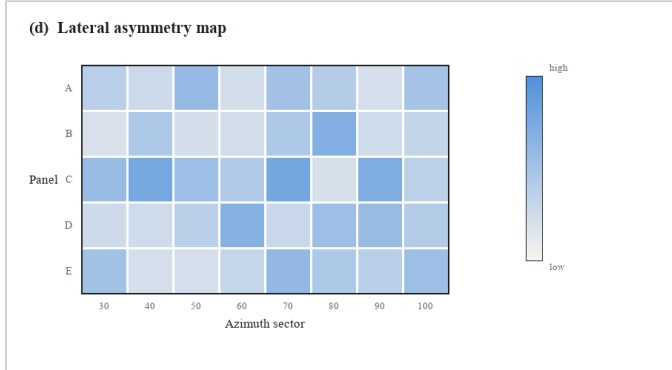

# A Synthetic Benchmark for Layout-Preserving Scientific Translation

用于布局保持的科学翻译的合成基准

A. Example, B. Sample, and C. Demo

A. 示例，B. 样本，以及 C. 演示

Institute of Synthetic Documents, Example University, Nowhere

合成文件研究所，示例大学，某地

Abstract. This manuscript is intentionally synthetic. It exists to exercise a document-processing pipeline with two-column layout, running headers and footers, inline and display mathematics, raster figures, and tables. The text is written in plain academic English; all names, institutions, measurements, and citations are fictional. No result in this document should be interpreted as a scientific claim. The layout is designed to be parsed, translated, and rendered back without losing formulas, images, or table structure.

摘要。本文手稿为刻意合成的产物。其目的在于测试一个具备双栏版式、页眉页脚、行内及展示数学公式、位图图像以及表格的文档处理流程。文本采用标准的学术英语撰写；文中所有人名、机构、测量数据及引用均为虚构。本文档中的任何结果均不应被解读为科学主张。该版式设计旨在确保在解析、翻译及重新渲染过程中，不丢失公式、图像或表格结构。

Keywords: synthetic document; layout preservation; scientific translation; evaluation

关键词：合成文档；布局保持；科学翻译；评估

## 1. Introduction

1. 引言

Document translation systems are often evaluated on plain text, where paragraphs flow without columns, floats, or numbered equations. Real scientific manuscripts are less cooperative. A single page may combine a two-column body, a full-width abstract, inline symbols, display equations, a figure caption, and a table whose header is split into several cells. A translation that ignores this structure can be readable and still be wrong: formulas drift out of order, captions attach to the wrong image, and table headers lose their meaning.

文档翻译系统通常在纯文本上进行评估，其中段落连续排列，没有分栏、浮动元素或编号公式。真实的科学手稿则不那么配合。单页可能包含双栏正文、全宽摘要、行内符号、显示公式、图注以及表头被分割成多个单元格的表格。忽略这种结构的翻译虽然可读，但仍可能出错：公式顺序错乱、图注与错误的图像关联、表头失去其含义。

This demo document isolates those layout features. It is not a study of any physical system. The numbers in the figures are generated by simple functions, and the references are invented. The goal is to provide a compact, redistributable input for testing a deterministic parsing and rendering pipeline, and for showing what a translated version looks like when the original layout is respected.

本演示文档隔离了这些布局特性。它并非对任何物理系统的研究。图中的数字由简单函数生成，参考文献也是虚构的。其目标是提供一个紧凑且可再分发的输入，用于测试确定性解析和渲染流水线，并展示在尊重原始布局的情况下，译文呈现出的效果。

A second motivation is reproducibility. Papers used in layout experiments are often copyrighted, large, or difficult to redistribute. A synthetic manuscript can be checked into a repository, regenerated from source, and compared across tools without asking a reader to download a real publication. The source of this document is a single HTML file; the PDF is produced by a headless browser and the figures are generated by a short script.

第二个动机是可复现性。用于布局实验的论文通常受版权保护、体积庞大或难以重新分发。合成手稿可以提交到仓库中，从源代码重新生成，并可在不同工具间进行比较，而无需读者下载真实的出版物。该文档的源文件为单个 HTML 文件；PDF 由无头浏览器生成，图像则由简短脚本生成。

## 2. Pipeline Overview

2. 流水线概述

The processing pipeline has four deterministic stages. First, the PDF is parsed into a structured intermediate representation. Second, the representation is split into translatable text units while formulas and images are preserved as opaque objects. Third, the units are translated by a language model. Fourth, the translated units are written back into the representation and rendered by the original document renderer. Quality gates compare formula counts, image paths, table structure, and citation markers before the result is accepted.

处理流程包含四个确定性阶段。首先，将 PDF 解析为结构化的中间表示。其次，将该表示拆分为可翻译的文本单元，同时保留公式和图像作为不透明对象。第三，由语言模型对这些单元进行翻译。第四，将翻译后的单元写回表示，并由原始文档渲染器进行渲染。在结果被接受之前，质量检查点会比对公式数量、图像路径、表格结构和引用标记。

Figure 1. A synthetic block diagram of the processing pipeline. The language model only sees text units; formulas, images, and table structure remain under the control of deterministic scripts.

图 1. 处理流程的合成框图。语言模型仅接收文本单元；公式、图像和表格结构仍由确定性脚本控制。

The separation matters because language models are good at rewriting sentences and poor at preserving byte-level structure. A model that is asked to reproduce a full page will eventually move a parenthesis or merge two table cells. A model that is asked to translate one paragraph at a time, with formulas replaced by protected placeholders, has a much smaller surface for error.

这种分离至关重要，因为语言模型擅长重写句子，却不擅长保留字节级结构。若要求模型复现整页内容，它最终可能会移动括号或合并两个表格单元格。而若要求模型逐段翻译，并将公式替换为受保护的占位符，其出错的可能性将大幅降低。

## 2.1. Design constraints

2.1. 设计约束

The pipeline is constrained to local parsing and local rendering. No page is uploaded to a remote parsing service. The translator may be a hosted model or a local model; this choice affects cost and latency but not the layout contract. The contract is simple: every formula, image, and table cell in the output must correspond to an object in the input.

该流水线仅限于本地解析和本地渲染，不会将任何页面上传到远程解析服务。翻译器可以是托管模型或本地模型；这一选择会影响成本和延迟，但不会影响布局契约。该契约很简单：输出中的每一个公式、图像和表格单元格都必须对应输入中的一个对象。

## 2.1.1. Scope of the sample

2.1.1. 样本范围

The sample is intentionally small. It contains four figures, two tables, six display equations, and a handful of inline symbols; a real paper may contain ten times as many. The point is not scale but variety: the sample includes a diagram, a line chart, a bar chart, a heat map, a table with a split header, and equations with fractions, integrals, and limits. These are the objects most likely to be damaged by a text-only translation.

样本是故意选取的小样本。它包含四幅图、两个表、六个显示公式以及若干行内符号；而真实论文可能包含十倍于此的数量。重点不在于规模而在于多样性：该样本包括示意图、折线图、柱状图、热力图、具有分割表头的表格，以及包含分数、积分和极限的公式。这些是最容易因纯文本翻译而受损的对象。

## 2.2. Governing equations

2.2. 控制方程

To exercise display mathematics, the document includes equations of different shapes: a conservation law, a dimensionless group, an integral definition, and a transform pair. None of them is used in a derivation; they are layout objects. The first expression is a compact form of the incompressible momentum balance,

为展示数学排版效果，文档包含了不同形式的方程：守恒律、无量纲群、积分定义以及变换对。这些方程均未用于推导过程，而是作为布局对象存在。第一个表达式是不可压缩动量平衡的紧凑形式，

$$
\rho \left(\frac {\partial u}{\partial t} + (u \cdot \nabla) u\right) = - \nabla p + \mu \nabla^ {2} u + f\qquad(1)
$$

where 𝑢 is a velocity field, 𝑝 is pressure, 𝜇 is dynamic viscosity, and f collects body forces. A dimensionless group is then defined as

其中 𝑢 是速度场，𝑝 是压力，𝜇 是动力黏度，f 表示体积力。随后定义无量纲群

$$
\mathrm{Re} = \frac {\rho U L}{\mu},\qquad(2)
$$

with 𝑈 a reference speed and 𝐿 a reference length. The lift coefficient is written as an integral over a chord,

其中 𝑈 是参考速度，𝐿 是参考长度。升力系数写成沿弦长的积分，

$$
C _ {L} = \frac {1}{0 . 5 \rho U ^ {2} c} \int_ {0} ^ {c} (p _ {l} - p _ {u}) d x,\qquad(3)
$$

and the final pair is a Fourier transform and its inverse, included to test nested superscripts and limits:

而最后一对是傅里叶变换及其逆变换，用于测试嵌套上标和极限：

$$
F \Bigg (\omega \Bigg) = \int_ {- \infty} ^ {+ \infty} f \Bigg (t \Bigg) e ^ {- i \omega t} d t.\qquad(4)
$$

## 2.3. Surrogate response

2.3. 替代响应

Figure 2 shows two synthetic responses. The solid curve is a damped oscillation; the dashed curve is a power law. The two curves cross near the middle of the range, which makes the legend and the line styles useful for checking whether a renderer preserves figure internals rather than replacing the figure with a caption.

图 2 展示了两个合成响应。实线为阻尼振荡曲线；虚线为幂律曲线。两条曲线在范围的中部附近相交，这使得图例和线型可用于检查渲染器是保留了图形内部结构，还是用说明文字替换了图形。

Figure 2. Synthetic thrust coefficient versus flight speed. The curves are generated from simple functions; the crossing point is intentional.

图 2. 合成推力系数与飞行速度的关系。曲线由简单函数生成；交点为有意设置。

Table 1 lists the parameters of the synthetic cases. The values are chosen to make the table narrow enough for one column but wide enough to require a header row and a unit row. The last column is right-aligned to test numeric alignment.

表 1 列出了合成案例的参数。这些值的选取旨在使表格足够窄以容纳一列，但又足够宽。足以需要表头行和单位行。最后一列右对齐以测试数字对齐。

Table 1. Synthetic case definitions.

表 1. 合成病例定义。

| 案例 | 速度 (m/s) | 角度 (°) | 权重 |
| --- | --- | --- | --- |
| C1 | 30 | 2.0 | 0.25 |
| C2 | 60 | 3.5 | 0.40 |
| C3 | 90 | 5.0 | 0.55 |
| C4 | 110 | 6.5 | 0.70 |

## 2.4. Evaluation protocol

2.4. 评估协议

The protocol is deliberately mechanical. Each translated output is compared with the source at three levels: object level (counts and order of formulas, figures, tables), block level (paragraph boundaries, captions, headers and footers), and text level (a short human readability score). The first two are computed by scripts, while the third is a brief manual review of a fixed sample. A document passes when all structural checks are exact and no sampled paragraph changes the meaning of its source.

该协议刻意采用机械化的方式。每个翻译输出均在三个层面与原文进行比对：对象层面（公式、图表的数量及顺序）、块级层面（段落边界、标题、页眉页脚）以及文本层面（简短的人类可读性评分）。前两项由脚本自动计算，第三项则是对固定样本进行简要的人工复核。当所有结构检查完全精确，且没有任何抽样段落改变其原文含义时，文档即视为通过。

## 2.4.1. Structural checks

2.4.1. 结构检验

Formula checks compare the sequence of LaTeX strings, not only their number. Image checks compare the set of referenced asset paths and their order of appearance. Table checks compare row and column counts and the text of the header row. Citation checks compare the multiset of bracketed numbers. These checks are intentionally strict; a single reordered formula is treated as a failure even if the surrounding prose remains readable.

公式检查不仅比较数量，还比较 LaTeX 字符串的序列。图像检查比较引用的资源路径集合及其出现顺序。表格检查比较行和列的数量以及表头行的文本。引用检查比较方括号内数字的多重集。这些检查是故意严格的；即使周围的正文仍然可读，单个重新排序的公式也被视为失败。

## 2.4.2. Sampling

2.4.2. 采样

Human review uses a fixed sample: the abstract, the first paragraph of each section, the paragraph before and after each display equation, and every figure caption. This sample is small enough to review in a few minutes and broad enough to catch the common failure modes. It is not intended to estimate translation quality statistically; it is a smoke test for the layout contract.

人工审查采用固定样本：包括摘要、每个部分的第一段、每个显示公式的前后段落以及每个图表的图注。该样本量足够小，可在几分钟内完成审查，又足够广泛，能够捕捉常见的失效模式。它并非用于统计估计翻译质量，而是对布局合同的一种“冒烟测试”。

## 2.5. Failure modes

2.5. 失效模式

Three failure modes motivate the checks. The first is formula drift: a model may translate a sentence and quietly drop a subscript or move a parenthesis. The second is caption attachment: a model may merge a figure caption into the preceding paragraph, so the caption no longer belongs to the image. The third is table fragmentation: a header cell may be split into several cells by subscripts, and a model may translate the fragments as independent words. Each failure is visible in the structural diff, even when the prose reads smoothly.

三种失效模式促使我们进行这些检查。第一种是公式漂移：模型可能在翻译句子时静默地丢失下标或移动括号。第二种是标题附着：模型可能将图注合并到前一段落中，导致该图注不再属于图像。第三种是表格碎片化：表头单元格可能被下标分割成多个单元格，而模型将这些碎片翻译为独立的单词。即使行文流畅，每种失效模式在结构差异中都是可见的。

## 3. Results

3. 结果

The synthetic results are presented in two forms. Figure 3 compares the maximum coefficient across five conditions, and Table 2 reports the same values in a compact matrix. The bar chart uses two colors and a legend; the table uses a split header. Both are common in real papers and both are easy to damage during translation if the renderer treats a figure as a paragraph or a table as a single text block.

合成结果以两种形式呈现。图 3 比较了五种条件下的最大系数，表 2 则以紧凑矩阵形式报告了相同的数值。柱状图使用了两种颜色及图例，表格则采用了分割表头。这两种形式在真实论文中都很常见，但如果渲染器将图表视为段落或将表格视为单一文本块，两者在翻译过程中都容易受损。

Figure 3. Maximum thrust coefficient for installed and isolated configurations. The bars are synthetic and do not represent a physical experiment.

图 3. 安装与隔离构型下的最大推力系数。柱状图为合成数据，不代表物理实验。

Figure 4 is a heat map with row and column labels. It is included because heat maps often contain many small labels that are easy to lose when an image is re-encoded. The color bar is part of the image, not a separate legend.

图 4 是一个带有行列标签的热力图。之所以包含它，是因为热力图通常包含许多微小的标签，在图像重新编码时这些标签很容易丢失。颜色条是图像的一部分，而非独立的图例。

Figure 4. Synthetic lateral asymmetry map. Rows are panels and columns are azimuth sectors; the color scale is arbitrary.

图 4. 合成横向不对称图。行代表面板，列代表方位扇区；颜色标度为任意设定。

## 3.1. Observations

3.1. 观测

Three observations follow from the synthetic data. First, the installed configuration has a higher peak in the middle of the speed range. Second, the isolated configuration grows monotonically, so the two curves cross. Third, the heat map shows a diagonal pattern that makes it easy to see whether row and column labels stayed attached to their cells.

由此合成数据可得出三点观察结果。首先，安装配置在速度范围的中部具有更高的峰值。其次，隔离配置呈单调增长，因此两条曲线相交。第三，热图显示出对角线模式，便于判断行和列标签是否仍与其单元格关联。

$$
\min_{x\in \mathbb{R}^{n}}\frac{1}{2}\| Ax - b\|_{2}^{2} + \lambda \| x\|_{1}\qquad(5)
$$

Equation (5) is a placeholder optimization objective, included only to test a second display style with an under-script and nested norms. The wake model in equation (6) is likewise illustrative:

公式 (5) 是一个占位符优化目标，仅用于测试带有下标和嵌套范数的第二种显示风格。公式 (6) 中的尾流模型同样具有说明性：

$$
u _ {w} \Bigg (x, r \Bigg) = U _ {\infty} \left[ 1 - \left(1 - \sqrt {1 - C _ {T}}\right) \exp \left(- \frac {r ^ {2}}{2 \sigma^ {2}}\right) \right]\qquad(6)
$$

Table 2. Synthetic coefficient matrix (dimensionless).

表 2. 合成系数矩阵（无量纲）。

| 案例 | 已安装 | 孤立 | 比率 |
| --- | --- | --- | --- |
| C1 | 0.31 | 0.28 | 1.11 |
| C2 | 0.42 | 0.36 | 1.17 |
| C3 | 0.51 | 0.44 | 1.16 |
| C4 | 0.46 | 0.40 | 1.15 |

The numbers are not physically meaningful. Their only purpose is to give the parser and the renderer something to check: three decimal places, a ratio column, and a caption above the table rather than below it.

这些数值没有物理意义。它们唯一的作用是供解析器和渲染器进行检查：保留三位小数、包含比率列，以及将表格标题置于表格上方而非下方。

## 3.2. Ablation

3.2. 消融实验

To make the layout test more informative, we compare three renderings of the same synthetic page. The first keeps the original two columns and all floats. The second collapses the body to a single column but keeps the figures and tables in place. The third converts the page to plain text and drops the figures. The first rendering is the only one that satisfies the structural checks; the second loses column-level ordering, and the third loses four images and two tables. This ablation is trivial, but it shows why a structural diff is necessary: all three renderings can be read, and only the first preserves the document as an object.

为了使布局测试更具信息量，我们对比了同一合成页面的三种渲染方式。第一种保持原有的两栏结构和所有浮动元素；第二种将正文合并为单栏，但保留图片和表格的原有位置；第三种将页面转换为纯文本并移除图片。只有第一种渲染方式满足结构检查；第二种丢失了栏级顺序，第三种丢失了四张图片和两张表格。这一消融实验虽然简单，但它说明了为何需要结构差异检测：三种渲染方式均可被阅读，但只有第一种保留了文档作为对象的完整性。

## 3.3. Qualitative check

3.3. 定性检查

A short manual review of the sampled paragraphs found no missing sentences in the synthetic source. The main readability issue is expected: fictional technical prose contains many noun phrases and few pronouns, so a literal translation can sound repetitive. This is a property of the sample, not a property of the pipeline. A real evaluation should use domain text and a reviewer familiar with the field.

对采样段落的简短人工审查未发现合成源中缺失的句子。主要可读性问题是预期的：虚构的技术散文包含大量名词短语而很少使用代词，因此直译听起来会显得重复。这是样本本身的特性，而非流程的特性。真正的评估应使用领域文本，并由熟悉该领域的评审员进行。

## 3.4. Discussion of the numbers

3.4. 数字讨论

The numerical values in Figures 2–4 are generated, not measured. They are chosen to exercise axis labels, legends, and color bars; they should not be compared with any physical data. The only meaningful comparison is between the source PDF and the translated output: the figures should look the same, and the numbers in the text should match the numbers in the figures.

图 2–4 中的数值为生成值而非测量值。这些数值用于测试坐标轴标签、图例和颜色条；不应将其与任何物理数据进行比较。唯一有意义的比较是源 PDF 与翻译输出之间的比较：图表应保持一致，文本中的数值应与图表中的数值相匹配。

## 4. Discussion

4. 讨论

Layout-preserving translation is a constraint satisfaction problem disguised as a language task. The language model can choose words, but it cannot be allowed to choose which formulas survive, where an image sits, or how many cells a table contains. The synthetic manuscript makes those constraints visible: a translated version should still have six display equations, four figures, two tables, and a running header and footer on every page.

布局保持的翻译是一种伪装成语言任务的约束满足问题。语言模型可以选择词汇，但不允许它决定哪些公式得以保留、图像位于何处，或表格包含多少个单元格。合成手稿使这些约束变得可见：翻译后的版本仍应包含六个显示公式、四幅插图、两个表格，以及每页的页眉和页脚。

A practical evaluation should therefore combine a human readability score with a structural diff. Readability alone will not catch a missing minus sign in an equation; structural diff alone will not catch a sentence that is grammatical but has the opposite meaning. The two checks are complementary, and both are cheaper than re-reading a badly translated page from scratch.

因此，实际评估应将人类可读性评分与结构差异检测相结合。仅凭可读性无法发现公式中缺失的负号；仅凭结构差异也无法识别语法正确但含义相反的语句。这两种检查互为补充，且都比从头重新阅读翻译不佳的页面成本更低。

## 4.1. What this demo does not test

4.1. 本演示未测试的内容

This document does not test scanned pages, handwritten annotations, rotated text, multi-column tables that span a page break, or equations that are embedded as images. Those cases are important but harder to generate synthetically. It also does not test citation resolution beyond simple bracketed numbers.

本文档未测试扫描页面、手写注释、旋转文本、跨越分页的多栏表格，或作为图像嵌入的公式。这些情况固然重要，但更难通过合成方式生成。此外，本文档也未测试超出简单方括号数字之外的引用解析。

## 4.2. Reproducibility

4.2. 可复现性

The PDF is generated from a single HTML file with a headless browser. The four figures are generated by a short Python script using Pillow. The content is fictional, so the whole sample can be redistributed with the project without a copyright review. A future version can add a second sample with a scanned page and a third with a complex table.

PDF 由无头浏览器从单个 HTML 文件生成。四个图表由使用 Pillow 库的简短 Python 脚本生成。内容均为虚构，因此整个样本可与项目一起重新分发，无需进行版权审查。未来版本可增加第二个样本（扫描页面）和第三个样本（复杂表格）。

## 4.3. Threats to validity

4.3. 效度威胁

The sample is small and synthetic, so it cannot establish that the pipeline works on every real paper. It also excludes adversarial cases: pages with overlapping text, equations rendered as images, or tables that continue across a page break. Those cases are common enough that a production evaluation should include them. The structural checks are necessary but not sufficient; they do not prove that a translation is correct, only that the document has not been deformed.

样本规模较小且为合成数据，因此无法证明该流程适用于所有真实论文。此外，该样本还排除了对抗性情况：包含重叠文本、以图像形式呈现的公式或跨页断开的表格。此类情况在实际应用中十分常见，因此生产环境下的评估应将其纳入。结构检查是必要的，但并非充分条件；它们只能证明文档未被变形，并不能证明翻译是正确的。

## 4.4. Future samples

4.4. 未来样本

A useful next step is a small suite rather than a single document: one synthetic paper with a long table, one scanned page with OCR noise, and one paper with a figure that spans two columns. The suite should be small enough to review by hand and diverse enough to expose different failure modes. The source for each sample should be checked in, so the PDF can be regenerated and the comparison repeated after a code change.

一个有用的下一步是构建一个小规模的测试套件，而非单一文档：包含一份带有长表格的合成论文、一份带有 OCR 噪声的扫描页面，以及一份跨两栏的插图论文。该套件应足够小以便人工审查，同时足够多样化以暴露不同的故障模式。每个样本的源文件应被提交入库，以便在代码变更后能够重新生成 PDF 并重复比较。

## 4.5. Practical recommendation

4.5. 实用建议

For a translation tool, the most useful output is not a perfect page but a page whose failures are visible. A structural report that names the affected block is more valuable than a fluent translation that silently loses an equation. The demo is designed around that principle: it is easy to see what should be preserved, and easy to check whether it survived.

对于翻译工具而言，最有价值的输出并非完美无瑕的页面，而是那些错误清晰可见的页面。一份明确指出受影响区块的结构化报告，远比一份静默丢失公式却通顺流畅的译文更有价值。该演示正是基于这一原则设计的：它既便于查看应保留的内容，也便于检查这些内容是否得以保留。

## 5. Conclusion

5. 结论

We have described a small synthetic manuscript for testing layout-preserving translation. It combines two-column text, running headers and footers, display and inline mathematics, raster figures, and tables. The document is intentionally boring: its value is that it is reproducible, redistributable, and structurally rich enough to expose failures that plain-text tests miss.

我们描述了一份用于测试布局保持翻译的小型合成手稿。它包含双栏文本、页眉页脚、显示公式和内联数学公式、位图图像以及表格。该文档故意设计得平淡无奇：其价值在于可复现、可重新分发，并且结构足够丰富，能够揭示纯文本测试所遗漏的失败情况。

All content in this file is fictional. Names, af iliations, measurements, and references were invented for layout testing; they do not describe a real study.

本文件中的所有内容均为虚构。姓名、隶属关系、测量数据和参考文献均为布局测试而虚构，并不代表真实研究。

## References

参考文献

[1] A. Example. “A fictitious survey of synthetic documents.” Journal of Reproducible Layouts, 12(3):45–61, 2024. (Fictional.)

[2] B. Sample and C. Demo. “Rendering contracts for translated manuscripts.” In Proceedings of the Synthetic Document Workshop, pages 1–8, 2025. (Fictional.)

[3] D. Placeholder. “On the stability of two-column layouts.” Demo Letters, 7(2):101–119, 2023. (Fictional.)

[4] E. Example. “Quality gates for formula-preserving translation.” Preprint, arXiv:0000.00000, 2026. (Fictional.)

[5] F. Sample. “A note on synthetic benchmarks.” Technical Report TR-00, Example University, 2025. (Fictional.)