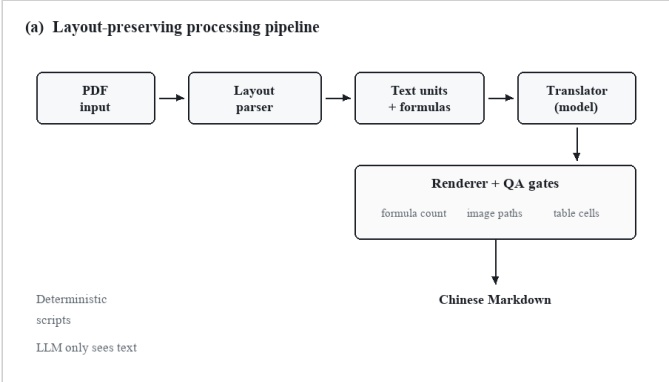
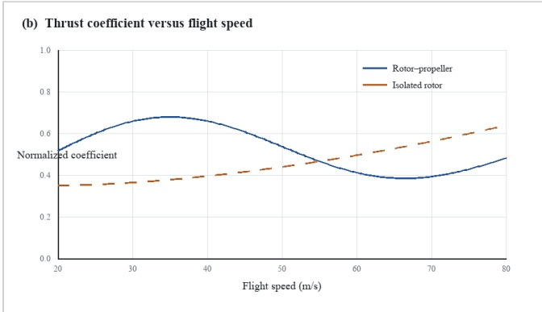
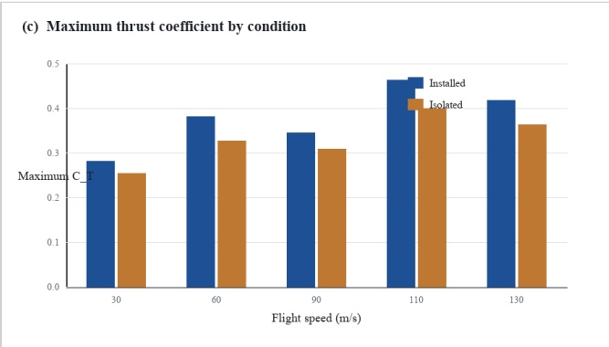
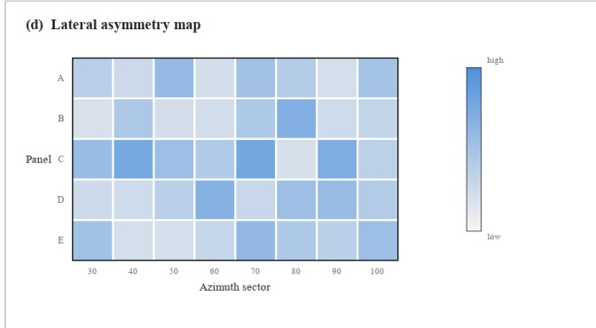

# 面向版式保真的科学翻译合成基准

作者：A. Example, B. Sample, and C. Demo

合成文献研究所，示例大学，无名镇

摘要。本文档为刻意合成的文本，用于检验一条文档处理流水线：双栏排版、页眉页脚、行内与行间数学、位图插图和表格。正文使用平实的学术英语；所有姓名、机构、测量值和引用均为虚构。本文中的任何结果都不应被视为科学结论。该版式旨在被解析、翻译并重新渲染，同时不丢失公式、图片或表格结构。

关键词：合成文档；版式保真；科学翻译；评测

## 1. 引言

文档翻译系统通常只在纯文本上评测，那里的段落没有分栏、浮动体或编号公式。真实的科学文稿要难缠得多：同一页可能同时出现双栏正文、通栏摘要、行内符号、行间公式、图注，以及表头被拆成多个单元格的表格。忽略这种结构的译文可能读起来通顺，却仍然是错的：公式顺序漂移、图注挂到错误的图片上、表头失去含义。

本演示文档专门隔离这些版式特征。它不是对任何物理系统的研究。图中的数字由简单函数生成，参考文献也是编造的。目标是提供一个紧凑、可再分发的输入，用于测试确定性的解析与渲染流水线，并展示在尊重原版式时译文是什么样子。

第二个动机是可复现性。用于版式实验的论文往往受版权保护、体积大或不便再分发。合成文稿可以纳入代码仓库，从源文件重新生成，并在不同工具之间比较，而不需要读者下载一篇真实出版物。本文的源文件只有一个 HTML 文件；PDF 由无头浏览器生成，插图由一段短脚本生成。

## 2. 流水线概览

处理流水线包含四个确定性阶段。第一，把 PDF 解析为结构化的中间表示。第二，把该表示切分为可翻译的文本单元，同时把公式和图片保留为不透明对象。第三，由语言模型翻译这些单元。第四，把译好的单元写回表示，并交由原文档渲染器渲染。在接收结果之前，质量闸门会比对公式数量、图片路径、表格结构和引用标记。

图 1. 处理流水线的合成框图。语言模型只能看到文本单元；公式、图片和表格结构始终由确定性脚本控制。

这种分离很重要，因为语言模型擅长改写句子，却不擅长保持字节级结构。要求模型复现整页内容，它迟早会移动一个括号或合并两个表格单元格；要求它一次只翻译一段、并用受保护的占位符替换公式，出错面就小得多。

## 2.1. 设计约束

流水线限定在本地解析和本地渲染。任何页面都不会上传到远程解析服务。翻译器可以是在线模型，也可以是本地模型；这一选择影响成本和延迟，但不影响版式契约。契约很简单：输出中的每个公式、图片和表格单元格，都必须对应输入中的一个对象。

## 2.1.1. 样本范围

样本刻意做得较小。它包含四幅图、两张表、六个行间公式和少量行内符号；真实论文可能是这个数量的十倍。重点不是规模，而是多样性：样本包含框图、折线图、柱状图、热力图、带拆分表头的表格，以及含分数、积分和极限的公式。这些正是纯文本翻译最容易破坏的对象。

## 2.2. 控制方程

为了检验行间数学，文档包含形状不同的公式：一条守恒律、一个无量纲群、一个积分定义和一对变换。它们都不参与推导，只是版式对象。第一个表达式是不可压缩动量平衡的紧凑形式，

$$
\rho \left(\frac {\partial u}{\partial t} + (u \cdot \nabla) u\right) = - \nabla p + \mu \nabla^ {2} u + f\tag{1}
$$

其中 𝑢 是速度场，𝑝 是压力，𝜇 是动力黏度，f 表示体积力。随后定义无量纲群

$$
\mathrm{Re} = \frac {\rho U L}{\mu},\tag{2}
$$

其中 𝑈 是参考速度，𝐿 是参考长度。升力系数写成沿弦长的积分，

$$
C _ {L} = \frac {1}{0 . 5 \rho U ^ {2} c} \int_ {0} ^ {c} (p _ {l} - p _ {u}) d x,\tag{3}
$$

最后一对是傅里叶变换及其逆变换，用于检验嵌套上标和积分上下限：

$$
F \Bigg (\omega \Bigg) = \int_ {- \infty} ^ {+ \infty} f \Bigg (t \Bigg) e ^ {- i \omega t} d t.\tag{4}
$$

## 2.3. 代理响应

图 2 给出两条合成响应。实线是阻尼振荡，虚线是幂律。两条曲线在量程中段附近相交，因此图例和线型可用于检查渲染器是否保留了图形内部信息，而不是把整幅图替换成一条图注。

图 2. 合成推力系数随飞行速度的变化。曲线由简单函数生成；交点是有意设置的。

表 1 列出合成工况的参数。这些数值的选取使表格足够窄，能放进一栏，但又足够宽以需要表头行和单位行。最后一列右对齐，用于检验数字对齐。

表 1. 合成工况定义。

| 工况 | 速度（m/s） | 角度（°） | 权重 |
| --- | --- | --- | --- |
| C1 | 30 | 2.0 | 0.25 |
| C2 | 60 | 3.5 | 0.40 |
| C3 | 90 | 5.0 | 0.55 |
| C4 | 110 | 6.5 | 0.70 |

## 2.4. 评测协议

该协议刻意保持机械。每个译文都在三个层面与原文比较：对象层（公式、图、表的数量和顺序）、块层（段落边界、图注、页眉页脚）和文本层（简短的人工可读性评分）。前两层由脚本计算，第三层是对固定样本的简短人工复核。只有当所有结构检查完全一致，且抽样段落没有改变原意时，文档才算通过。

## 2.4.1. 结构检查

公式检查比较 LaTeX 字符串的序列，而不只是数量。图片检查比较被引用资源路径的集合及其出现顺序。表格检查比较行数、列数和表头行的文字。引用检查比较方括号编号的多重集。这些检查刻意严格：即使周围文字仍然可读，只要有一个公式顺序改变，就判为失败。

## 2.4.2. 抽样

人工复核使用固定样本：摘要、每节第一段、每个行间公式前后各一段，以及所有图注。这个样本小到几分钟能看完，又足够宽，能覆盖常见失败模式。它不用于统计估计翻译质量，而是版式契约的快速冒烟测试。

## 2.5. 失败模式

有三类失败模式促成了这些检查。第一是公式漂移：模型可能翻译一句话时悄悄丢掉下标或移动括号。第二是图注挂接：模型可能把图注并进前一段，使图注不再属于那张图。第三是表格碎片化：表头单元格可能被下标拆成几个单元格，模型把碎片当成独立词语翻译。每种失败都会在结构差异中显现，即使文字读起来很顺。

## 3. 结果

合成结果以两种形式呈现。图 3 比较五种工况下的最大系数，表 2 用紧凑矩阵报告同样的数值。柱状图使用两种颜色和一个图例；表格使用拆分表头。两者在真实论文中都很常见，如果渲染器把图当成段落、把表当成一个文本块，翻译时都很容易被破坏。

图 3. 装机与孤立构型的最大推力系数。柱状图为合成数据，不代表真实实验。

图 4 是带行列标签的热力图。加入它是因为热力图往往包含许多小标签，图片一旦重新编码就很容易丢失。色标是图片的一部分，不是单独的图例。

图 4. 合成侧向不对称图。行是翼板，列是方位扇区；色标是任意设定的。

## 3.1. 观察

由合成数据可得到三点观察。第一，装机构型在速度范围中段有更高的峰值。第二，孤立构型单调增长，因此两条曲线相交。第三，热力图呈现对角模式，便于看出行列标签是否仍附着在对应单元格上。

$$
\min_{x\in \mathbb{R}^{n}}\frac{1}{2}\| Ax - b\|_{2}^{2} + \lambda \| x\|_{1}\tag{5}
$$

式（5）是一个占位的优化目标，仅用于检验带下标和嵌套范数的第二种行间样式。式（6）中的尾流模型同样是示意性的：

$$
u _ {w} \Bigg (x, r \Bigg) = U _ {\infty} \left[ 1 - \left(1 - \sqrt {1 - C _ {T}}\right) \exp \left(- \frac {r ^ {2}}{2 \sigma^ {2}}\right) \right]\tag{6}
$$

表 2. 合成系数矩阵（无量纲）。

| 工况 | 装机 | 孤立 | 比值 |
| --- | --- | --- | --- |
| C1 | 0.31 | 0.28 | 1.11 |
| C2 | 0.42 | 0.36 | 1.17 |
| C3 | 0.51 | 0.44 | 1.16 |
| C4 | 0.46 | 0.40 | 1.15 |

这些数字没有物理意义。它们唯一的作用是给解析器和渲染器提供可检查的东西：三位小数、一个比值列，以及位于表格上方而不是下方的表题。

## 3.2. 消融

为了让版式测试更有信息量，我们比较同一合成页面的三种渲染。第一种保留原始双栏和所有浮动体；第二种把正文压成单栏，但保留图和表的位置；第三种把页面转成纯文本并丢弃插图。只有第一种渲染满足结构检查；第二种丢失了栏级顺序，第三种丢失了四幅图和两张表。这个消融很简单，却说明了结构差异为何必要：三种渲染都可读，但只有第一种把文档作为对象保留下来。

## 3.3. 定性检查

对抽样段落的简短人工复核没有发现合成原文有缺句。主要的可读性问题在意料之中：虚构的技术性文字包含大量名词短语、代词很少，直译容易显得重复。这是样本的属性，不是流水线的属性。真实评测应使用领域文本，并由熟悉该领域的审稿人检查。

## 3.4. 数值讨论

图 2 至图 4 中的数值是生成的，不是测量得到的。它们用于检验坐标轴标签、图例和色标；不应与任何物理数据比较。唯一有意义的比较是在原 PDF 与译文之间：图应看起来相同，正文中的数字应与图中的数字一致。

## 4. 讨论

版式保真翻译是一个伪装成语言任务的约束满足问题。语言模型可以选择措辞，但不能决定哪些公式保留、图片放在哪里，或表格有多少个单元格。合成文稿让这些约束变得可见：译文仍应有六个行间公式、四幅图、两张表，并且每页都有页眉和页脚。

因此，实用的评测应把人工可读性评分与结构差异结合起来。只看可读性，抓不住公式里丢失的负号；只看结构差异，抓不住语法正确但意思相反的句子。两种检查互补，而且都比从头重读一张译坏的页面便宜。

## 4.1. 本演示未测试的内容

本文档没有测试扫描页、手写批注、旋转文字、跨页断开的跨栏表格，或作为图片嵌入的公式。这些情况很重要，但更难合成生成。它也没有测试简单方括号编号之外的引用解析。

## 4.2. 可复现性

PDF 由单个 HTML 文件经无头浏览器生成。四幅图由一段使用 Pillow 的短 Python 脚本生成。内容是虚构的，因此整个样本可以随项目再分发，无需版权审查。未来版本可以增加一个含扫描页的样本，以及一个含复杂表格的样本。

## 4.3. 有效性威胁

样本规模小且是合成的，因此不能证明流水线适用于所有真实论文。它还排除了对抗性情况：文字重叠的页面、以图片形式渲染的公式，或跨页断开的表格。这些情况足够常见，生产环境评测应包含它们。结构检查必要但不充分；它们不能证明译文正确，只能证明文档没有被变形。

## 4.4. 未来样本

一个有用的下一步是小型样本套件，而不是单篇文档：一篇含长表格的合成论文、一页带 OCR 噪声的扫描页，以及一篇含跨两栏插图的论文。套件应小到可以人工复核，又足够多样，能暴露不同失败模式。每个样本的源文件都应纳入版本控制，以便重新生成 PDF，并在代码变更后重复比较。

## 4.5. 实用建议

对翻译工具而言，最有用的输出不是完美页面，而是失败可见的页面。一份点名受影响块的结构报告，比一份悄悄丢掉公式却读起来流畅的译文更有价值。本演示正是围绕这一原则设计的：哪些内容应当保留一目了然，是否保留下来也容易检查。

## 5. 结论

我们描述了一份用于测试版式保真翻译的小型合成文稿。它结合了双栏正文、页眉页脚、行间与行内数学、位图插图和表格。这份文档刻意平淡：它的价值在于可复现、可再分发，并且结构足够丰富，能暴露纯文本测试漏掉的失败。

本文所有内容均为虚构。姓名、所属机构、测量值和参考文献都是为版式测试编造的；它们不描述真实研究。

## 参考文献

[1] A. Example. “A fictitious survey of synthetic documents.” Journal of Reproducible Layouts, 12(3):45–61, 2024. (Fictional.)

[2] B. Sample and C. Demo. “Rendering contracts for translated manuscripts.” In Proceedings of the Synthetic Document Workshop, pages 1–8, 2025. (Fictional.)

[3] D. Placeholder. “On the stability of two-column layouts.” Demo Letters, 7(2):101–119, 2023. (Fictional.)

[4] E. Example. “Quality gates for formula-preserving translation.” Preprint, arXiv:0000.00000, 2026. (Fictional.)

[5] F. Sample. “A note on synthetic benchmarks.” Technical Report TR-00, Example University, 2025. (Fictional.)