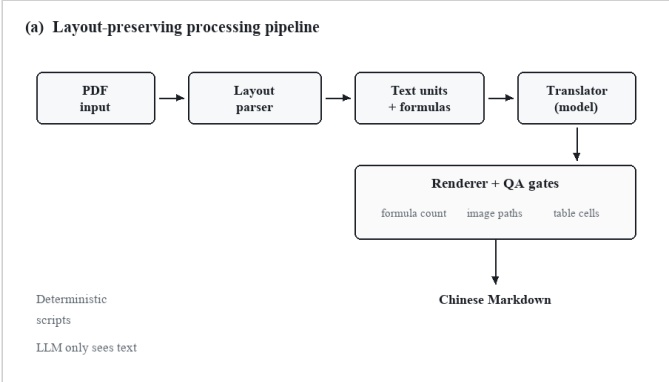
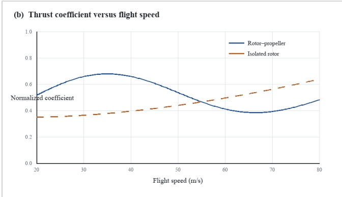
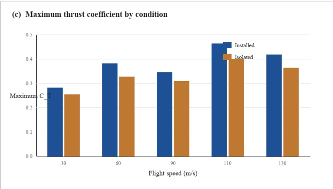
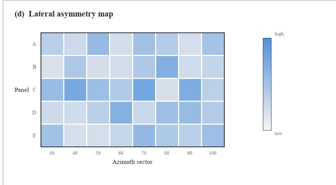

# A Synthetic Benchmark for Layout-Preserving Scientific Translation

面向版式保真的科学翻译合成基准

A. Example, B. Sample, and C. Demo

作者：A. Example, B. Sample, and C. Demo

Institute of Synthetic Documents, Example University, Nowhere

合成文献研究所，示例大学，无名镇

Abstract. This manuscript is intentionally synthetic. It exists to exercise a document-processing pipeline with two-column layout, running headers and footers, inline and display mathematics, raster figures, and tables. The text is written in plain academic English; all names, institutions, measurements, and citations are fictional. No result in this document should be interpreted as a scientific claim. The layout is designed to be parsed, translated, and rendered back without losing formulas, images, or table structure.

摘要。本文档为刻意合成的文本，用于检验一条文档处理流水线：双栏排版、页眉页脚、行内与行间数学、位图插图和表格。正文使用平实的学术英语；所有姓名、机构、测量值和引用均为虚构。本文中的任何结果都不应被视为科学结论。该版式旨在被解析、翻译并重新渲染，同时不丢失公式、图片或表格结构。

Keywords: synthetic document; layout preservation; scientific translation; evaluation

关键词：合成文档；版式保真；科学翻译；评测

## 1. Introduction

1. 引言

Document translation systems are often evaluated on plain text, where paragraphs flow without columns, floats, or numbered equations. Real scientific manuscripts are less cooperative. A single page may combine a two-column body, a full-width abstract, inline symbols, display equations, a figure caption, and a table whose header is split into several cells. A translation that ignores this structure can be readable and still be wrong: formulas drift out of order, captions attach to the wrong image, and table headers lose their meaning.

文档翻译系统通常只在纯文本上评测，那里的段落没有分栏、浮动体或编号公式。真实的科学文稿要难缠得多：同一页可能同时出现双栏正文、通栏摘要、行内符号、行间公式、图注，以及表头被拆成多个单元格的表格。忽略这种结构的译文可能读起来通顺，却仍然是错的：公式顺序漂移、图注挂到错误的图片上、表头失去含义。

This demo document isolates those layout features. It is not a study of any physical system. The numbers in the figures are generated by simple functions, and the references are invented. The goal is to provide a compact, redistributable input for testing a deterministic parsing and rendering pipeline, and for showing what a translated version looks like when the original layout is respected.

本演示文档专门隔离这些版式特征。它不是对任何物理系统的研究。图中的数字由简单函数生成，参考文献也是编造的。目标是提供一个紧凑、可再分发的输入，用于测试确定性的解析与渲染流水线，并展示在尊重原版式时译文是什么样子。

A second motivation is reproducibility. Papers used in layout experiments are often copyrighted, large, or difficult to redistribute. A synthetic manuscript can be checked into a repository, regenerated from source, and compared across tools without asking a reader to download a real publication. The source of this document is a single HTML file; the PDF is produced by a headless browser and the figures are generated by a short script.

第二个动机是可复现性。用于版式实验的论文往往受版权保护、体积大或不便再分发。合成文稿可以纳入代码仓库，从源文件重新生成，并在不同工具之间比较，而不需要读者下载一篇真实出版物。本文的源文件只有一个 HTML 文件；PDF 由无头浏览器生成，插图由一段短脚本生成。

## 2. Pipeline Overview

2. 流水线概览

The processing pipeline has four deterministic stages. First, the PDF is parsed into a structured intermediate representation. Second, the representation is split into translatable text units while formulas and images are preserved as opaque objects. Third, the units are translated by a language model. Fourth, the translated units are written back into the representation and rendered by the original document renderer. Quality gates compare formula counts, image paths, table structure, and citation markers before the result is accepted.

处理流水线包含四个确定性阶段。第一，把 PDF 解析为结构化的中间表示。第二，把该表示切分为可翻译的文本单元，同时把公式和图片保留为不透明对象。第三，由语言模型翻译这些单元。第四，把译好的单元写回表示，并交由原文档渲染器渲染。在接收结果之前，质量闸门会比对公式数量、图片路径、表格结构和引用标记。

Figure 1. A synthetic block diagram of the processing pipeline. The language model only sees text units; formulas, images, and table structure remain under the control of deterministic scripts.

图 1. 处理流水线的合成框图。语言模型只能看到文本单元；公式、图片和表格结构始终由确定性脚本控制。

The separation matters because language models are good at rewriting sentences and poor at preserving byte-level structure. A model that is asked to reproduce a full page will eventually move a parenthesis or merge two table cells. A model that is asked to translate one paragraph at a time, with formulas replaced by protected placeholders, has a much smaller surface for error.

这种分离很重要，因为语言模型擅长改写句子，却不擅长保持字节级结构。要求模型复现整页内容，它迟早会移动一个括号或合并两个表格单元格；要求它一次只翻译一段、并用受保护的占位符替换公式，出错面就小得多。

## 2.1. Design constraints

2.1. 设计约束

The pipeline is constrained to local parsing and local rendering. No page is uploaded to a remote parsing service. The translator may be a hosted model or a local model; this choice affects cost and latency but not the layout contract. The contract is simple: every formula, image, and table cell in the output must correspond to an object in the input.

流水线限定在本地解析和本地渲染。任何页面都不会上传到远程解析服务。翻译器可以是在线模型，也可以是本地模型；这一选择影响成本和延迟，但不影响版式契约。契约很简单：输出中的每个公式、图片和表格单元格，都必须对应输入中的一个对象。

## 2.1.1. Scope of the sample

2.1.1. 样本范围

The sample is intentionally small. It contains four figures, two tables, six display equations, and a handful of inline symbols; a real paper may contain ten times as many. The point is not scale but variety: the sample includes a diagram, a line chart, a bar chart, a heat map, a table with a split header, and equations with fractions, integrals, and limits. These are the objects most likely to be damaged by a text-only translation.

样本刻意做得较小。它包含四幅图、两张表、六个行间公式和少量行内符号；真实论文可能是这个数量的十倍。重点不是规模，而是多样性：样本包含框图、折线图、柱状图、热力图、带拆分表头的表格，以及含分数、积分和极限的公式。这些正是纯文本翻译最容易破坏的对象。

## 2.2. Governing equations

2.2. 控制方程

To exercise display mathematics, the document includes equations of different shapes: a conservation law, a dimensionless group, an integral definition, and a transform pair. None of them is used in a derivation; they are layout objects. The first expression is a compact form of the incompressible momentum balance,

为了检验行间数学，文档包含形状不同的公式：一条守恒律、一个无量纲群、一个积分定义和一对变换。它们都不参与推导，只是版式对象。第一个表达式是不可压缩动量平衡的紧凑形式，

$$
\rho \left(\frac {\partial u}{\partial t} + (u \cdot \nabla) u\right) = - \nabla p + \mu \nabla^ {2} u + f\qquad(1)
$$

where 𝑢 is a velocity field, 𝑝 is pressure, 𝜇 is dynamic viscosity, and f collects body forces. A dimensionless group is then defined as

其中 𝑢 是速度场，𝑝 是压力，𝜇 是动力黏度，f 表示体积力。随后定义无量纲群

$$
\mathrm{Re} = \frac {\rho U L}{\mu},\qquad(2)
$$

with 𝑈 a reference speed and 𝐿 a reference length. The lift coefficient is written as an integral over a chord,

其中 𝑈 是参考速度，𝐿 是参考长度。升力系数写成沿弦长的积分，

$$
C _ {L} = \frac {1}{0 . 5 \rho U ^ {2} c} \int_ {0} ^ {c} (p _ {l} - p _ {u}) d x,\qquad(3)
$$

and the final pair is a Fourier transform and its inverse, included to test nested superscripts and limits:

最后一对是傅里叶变换及其逆变换，用于检验嵌套上标和积分上下限：

$$
F \Bigg (\omega \Bigg) = \int_ {- \infty} ^ {+ \infty} f \Bigg (t \Bigg) e ^ {- i \omega t} d t.\qquad(4)
$$

## 2.3. Surrogate response

2.3. 代理响应

Figure 2 shows two synthetic responses. The solid curve is a damped oscillation; the dashed curve is a power law. The two curves cross near the middle of the range, which makes the legend and the line styles useful for checking whether a renderer preserves figure internals rather than replacing the figure with a caption.

图 2 给出两条合成响应。实线是阻尼振荡，虚线是幂律。两条曲线在量程中段附近相交，因此图例和线型可用于检查渲染器是否保留了图形内部信息，而不是把整幅图替换成一条图注。

Figure 2. Synthetic thrust coefficient versus flight speed. The curves are generated from simple functions; the crossing point is intentional.

图 2. 合成推力系数随飞行速度的变化。曲线由简单函数生成；交点是有意设置的。

Table 1 lists the parameters of the synthetic cases. The values are chosen to make the table narrow enough for one column but wide enough to require a header row and a unit row. The last column is right-aligned to test numeric alignment.

表 1 列出合成工况的参数。这些数值的选取使表格足够窄，能放进一栏，但又足够宽以需要表头行和单位行。最后一列右对齐，用于检验数字对齐。

Table 1. Synthetic case definitions.

表 1. 合成工况定义。

| 工况 | 速度（m/s） | 角度（°） | 权重 |
| --- | --- | --- | --- |
| C1 | 30 | 2.0 | 0.25 |
| C2 | 60 | 3.5 | 0.40 |
| C3 | 90 | 5.0 | 0.55 |
| C4 | 110 | 6.5 | 0.70 |

## 2.4. Evaluation protocol

2.4. 评测协议

The protocol is deliberately mechanical. Each translated output is compared with the source at three levels: object level (counts and order of formulas, figures, tables), block level (paragraph boundaries, captions, headers and footers), and text level (a short human readability score). The first two are computed by scripts, while the third is a brief manual review of a fixed sample. A document passes when all structural checks are exact and no sampled paragraph changes the meaning of its source.

该协议刻意保持机械。每个译文都在三个层面与原文比较：对象层（公式、图、表的数量和顺序）、块层（段落边界、图注、页眉页脚）和文本层（简短的人工可读性评分）。前两层由脚本计算，第三层是对固定样本的简短人工复核。只有当所有结构检查完全一致，且抽样段落没有改变原意时，文档才算通过。

## 2.4.1. Structural checks

2.4.1. 结构检查

Formula checks compare the sequence of LaTeX strings, not only their number. Image checks compare the set of referenced asset paths and their order of appearance. Table checks compare row and column counts and the text of the header row. Citation checks compare the multiset of bracketed numbers. These checks are intentionally strict; a single reordered formula is treated as a failure even if the surrounding prose remains readable.

公式检查比较 LaTeX 字符串的序列，而不只是数量。图片检查比较被引用资源路径的集合及其出现顺序。表格检查比较行数、列数和表头行的文字。引用检查比较方括号编号的多重集。这些检查刻意严格：即使周围文字仍然可读，只要有一个公式顺序改变，就判为失败。

## 2.4.2. Sampling

2.4.2. 抽样

Human review uses a fixed sample: the abstract, the first paragraph of each section, the paragraph before and after each display equation, and every figure caption. This sample is small enough to review in a few minutes and broad enough to catch the common failure modes. It is not intended to estimate translation quality statistically; it is a smoke test for the layout contract.

人工复核使用固定样本：摘要、每节第一段、每个行间公式前后各一段，以及所有图注。这个样本小到几分钟能看完，又足够宽，能覆盖常见失败模式。它不用于统计估计翻译质量，而是版式契约的快速冒烟测试。

## 2.5. Failure modes

2.5. 失败模式

Three failure modes motivate the checks. The first is formula drift: a model may translate a sentence and quietly drop a subscript or move a parenthesis. The second is caption attachment: a model may merge a figure caption into the preceding paragraph, so the caption no longer belongs to the image. The third is table fragmentation: a header cell may be split into several cells by subscripts, and a model may translate the fragments as independent words. Each failure is visible in the structural diff, even when the prose reads smoothly.

有三类失败模式促成了这些检查。第一是公式漂移：模型可能翻译一句话时悄悄丢掉下标或移动括号。第二是图注挂接：模型可能把图注并进前一段，使图注不再属于那张图。第三是表格碎片化：表头单元格可能被下标拆成几个单元格，模型把碎片当成独立词语翻译。每种失败都会在结构差异中显现，即使文字读起来很顺。

## 3. Results

3. 结果

The synthetic results are presented in two forms. Figure 3 compares the maximum coefficient across five conditions, and Table 2 reports the same values in a compact matrix. The bar chart uses two colors and a legend; the table uses a split header. Both are common in real papers and both are easy to damage during translation if the renderer treats a figure as a paragraph or a table as a single text block.

合成结果以两种形式呈现。图 3 比较五种工况下的最大系数，表 2 用紧凑矩阵报告同样的数值。柱状图使用两种颜色和一个图例；表格使用拆分表头。两者在真实论文中都很常见，如果渲染器把图当成段落、把表当成一个文本块，翻译时都很容易被破坏。

Figure 3. Maximum thrust coefficient for installed and isolated configurations. The bars are synthetic and do not represent a physical experiment.

图 3. 装机与孤立构型的最大推力系数。柱状图为合成数据，不代表真实实验。

Figure 4 is a heat map with row and column labels. It is included because heat maps often contain many small labels that are easy to lose when an image is re-encoded. The color bar is part of the image, not a separate legend.

图 4 是带行列标签的热力图。加入它是因为热力图往往包含许多小标签，图片一旦重新编码就很容易丢失。色标是图片的一部分，不是单独的图例。

Figure 4. Synthetic lateral asymmetry map. Rows are panels and columns are azimuth sectors; the color scale is arbitrary.

图 4. 合成侧向不对称图。行是翼板，列是方位扇区；色标是任意设定的。

## 3.1. Observations

3.1. 观察

Three observations follow from the synthetic data. First, the installed configuration has a higher peak in the middle of the speed range. Second, the isolated configuration grows monotonically, so the two curves cross. Third, the heat map shows a diagonal pattern that makes it easy to see whether row and column labels stayed attached to their cells.

由合成数据可得到三点观察。第一，装机构型在速度范围中段有更高的峰值。第二，孤立构型单调增长，因此两条曲线相交。第三，热力图呈现对角模式，便于看出行列标签是否仍附着在对应单元格上。

$$
\min_{x\in \mathbb{R}^{n}}\frac{1}{2}\| Ax - b\|_{2}^{2} + \lambda \| x\|_{1}\qquad(5)
$$

Equation (5) is a placeholder optimization objective, included only to test a second display style with an under-script and nested norms. The wake model in equation (6) is likewise illustrative:

式（5）是一个占位的优化目标，仅用于检验带下标和嵌套范数的第二种行间样式。式（6）中的尾流模型同样是示意性的：

$$
u _ {w} \Bigg (x, r \Bigg) = U _ {\infty} \left[ 1 - \left(1 - \sqrt {1 - C _ {T}}\right) \exp \left(- \frac {r ^ {2}}{2 \sigma^ {2}}\right) \right]\qquad(6)
$$

Table 2. Synthetic coefficient matrix (dimensionless).

表 2. 合成系数矩阵（无量纲）。

| 工况 | 装机 | 孤立 | 比值 |
| --- | --- | --- | --- |
| C1 | 0.31 | 0.28 | 1.11 |
| C2 | 0.42 | 0.36 | 1.17 |
| C3 | 0.51 | 0.44 | 1.16 |
| C4 | 0.46 | 0.40 | 1.15 |

The numbers are not physically meaningful. Their only purpose is to give the parser and the renderer something to check: three decimal places, a ratio column, and a caption above the table rather than below it.

这些数字没有物理意义。它们唯一的作用是给解析器和渲染器提供可检查的东西：三位小数、一个比值列，以及位于表格上方而不是下方的表题。

## 3.2. Ablation

3.2. 消融

To make the layout test more informative, we compare three renderings of the same synthetic page. The first keeps the original two columns and all floats. The second collapses the body to a single column but keeps the figures and tables in place. The third converts the page to plain text and drops the figures. The first rendering is the only one that satisfies the structural checks; the second loses column-level ordering, and the third loses four images and two tables. This ablation is trivial, but it shows why a structural diff is necessary: all three renderings can be read, and only the first preserves the document as an object.

为了让版式测试更有信息量，我们比较同一合成页面的三种渲染。第一种保留原始双栏和所有浮动体；第二种把正文压成单栏，但保留图和表的位置；第三种把页面转成纯文本并丢弃插图。只有第一种渲染满足结构检查；第二种丢失了栏级顺序，第三种丢失了四幅图和两张表。这个消融很简单，却说明了结构差异为何必要：三种渲染都可读，但只有第一种把文档作为对象保留下来。

## 3.3. Qualitative check

3.3. 定性检查

A short manual review of the sampled paragraphs found no missing sentences in the synthetic source. The main readability issue is expected: fictional technical prose contains many noun phrases and few pronouns, so a literal translation can sound repetitive. This is a property of the sample, not a property of the pipeline. A real evaluation should use domain text and a reviewer familiar with the field.

对抽样段落的简短人工复核没有发现合成原文有缺句。主要的可读性问题在意料之中：虚构的技术性文字包含大量名词短语、代词很少，直译容易显得重复。这是样本的属性，不是流水线的属性。真实评测应使用领域文本，并由熟悉该领域的审稿人检查。

## 3.4. Discussion of the numbers

3.4. 数值讨论

The numerical values in Figures 2–4 are generated, not measured. They are chosen to exercise axis labels, legends, and color bars; they should not be compared with any physical data. The only meaningful comparison is between the source PDF and the translated output: the figures should look the same, and the numbers in the text should match the numbers in the figures.

图 2 至图 4 中的数值是生成的，不是测量得到的。它们用于检验坐标轴标签、图例和色标；不应与任何物理数据比较。唯一有意义的比较是在原 PDF 与译文之间：图应看起来相同，正文中的数字应与图中的数字一致。

## 4. Discussion

4. 讨论

Layout-preserving translation is a constraint satisfaction problem disguised as a language task. The language model can choose words, but it cannot be allowed to choose which formulas survive, where an image sits, or how many cells a table contains. The synthetic manuscript makes those constraints visible: a translated version should still have six display equations, four figures, two tables, and a running header and footer on every page.

版式保真翻译是一个伪装成语言任务的约束满足问题。语言模型可以选择措辞，但不能决定哪些公式保留、图片放在哪里，或表格有多少个单元格。合成文稿让这些约束变得可见：译文仍应有六个行间公式、四幅图、两张表，并且每页都有页眉和页脚。

A practical evaluation should therefore combine a human readability score with a structural diff. Readability alone will not catch a missing minus sign in an equation; structural diff alone will not catch a sentence that is grammatical but has the opposite meaning. The two checks are complementary, and both are cheaper than re-reading a badly translated page from scratch.

因此，实用的评测应把人工可读性评分与结构差异结合起来。只看可读性，抓不住公式里丢失的负号；只看结构差异，抓不住语法正确但意思相反的句子。两种检查互补，而且都比从头重读一张译坏的页面便宜。

## 4.1. What this demo does not test

4.1. 本演示未测试的内容

This document does not test scanned pages, handwritten annotations, rotated text, multi-column tables that span a page break, or equations that are embedded as images. Those cases are important but harder to generate synthetically. It also does not test citation resolution beyond simple bracketed numbers.

本文档没有测试扫描页、手写批注、旋转文字、跨页断开的跨栏表格，或作为图片嵌入的公式。这些情况很重要，但更难合成生成。它也没有测试简单方括号编号之外的引用解析。

## 4.2. Reproducibility

4.2. 可复现性

The PDF is generated from a single HTML file with a headless browser. The four figures are generated by a short Python script using Pillow. The content is fictional, so the whole sample can be redistributed with the project without a copyright review. A future version can add a second sample with a scanned page and a third with a complex table.

PDF 由单个 HTML 文件经无头浏览器生成。四幅图由一段使用 Pillow 的短 Python 脚本生成。内容是虚构的，因此整个样本可以随项目再分发，无需版权审查。未来版本可以增加一个含扫描页的样本，以及一个含复杂表格的样本。

## 4.3. Threats to validity

4.3. 有效性威胁

The sample is small and synthetic, so it cannot establish that the pipeline works on every real paper. It also excludes adversarial cases: pages with overlapping text, equations rendered as images, or tables that continue across a page break. Those cases are common enough that a production evaluation should include them. The structural checks are necessary but not sufficient; they do not prove that a translation is correct, only that the document has not been deformed.

样本规模小且是合成的，因此不能证明流水线适用于所有真实论文。它还排除了对抗性情况：文字重叠的页面、以图片形式渲染的公式，或跨页断开的表格。这些情况足够常见，生产环境评测应包含它们。结构检查必要但不充分；它们不能证明译文正确，只能证明文档没有被变形。

## 4.4. Future samples

4.4. 未来样本

A useful next step is a small suite rather than a single document: one synthetic paper with a long table, one scanned page with OCR noise, and one paper with a figure that spans two columns. The suite should be small enough to review by hand and diverse enough to expose different failure modes. The source for each sample should be checked in, so the PDF can be regenerated and the comparison repeated after a code change.

一个有用的下一步是小型样本套件，而不是单篇文档：一篇含长表格的合成论文、一页带 OCR 噪声的扫描页，以及一篇含跨两栏插图的论文。套件应小到可以人工复核，又足够多样，能暴露不同失败模式。每个样本的源文件都应纳入版本控制，以便重新生成 PDF，并在代码变更后重复比较。

## 4.5. Practical recommendation

4.5. 实用建议

For a translation tool, the most useful output is not a perfect page but a page whose failures are visible. A structural report that names the affected block is more valuable than a fluent translation that silently loses an equation. The demo is designed around that principle: it is easy to see what should be preserved, and easy to check whether it survived.

对翻译工具而言，最有用的输出不是完美页面，而是失败可见的页面。一份点名受影响块的结构报告，比一份悄悄丢掉公式却读起来流畅的译文更有价值。本演示正是围绕这一原则设计的：哪些内容应当保留一目了然，是否保留下来也容易检查。

## 5. Conclusion

5. 结论

We have described a small synthetic manuscript for testing layout-preserving translation. It combines two-column text, running headers and footers, display and inline mathematics, raster figures, and tables. The document is intentionally boring: its value is that it is reproducible, redistributable, and structurally rich enough to expose failures that plain-text tests miss.

我们描述了一份用于测试版式保真翻译的小型合成文稿。它结合了双栏正文、页眉页脚、行间与行内数学、位图插图和表格。这份文档刻意平淡：它的价值在于可复现、可再分发，并且结构足够丰富，能暴露纯文本测试漏掉的失败。

All content in this file is fictional. Names, af iliations, measurements, and references were invented for layout testing; they do not describe a real study.

本文所有内容均为虚构。姓名、所属机构、测量值和参考文献都是为版式测试编造的；它们不描述真实研究。

## References

参考文献

[1] A. Example. “A fictitious survey of synthetic documents.” Journal of Reproducible Layouts, 12(3):45–61, 2024. (Fictional.)

[2] B. Sample and C. Demo. “Rendering contracts for translated manuscripts.” In Proceedings of the Synthetic Document Workshop, pages 1–8, 2025. (Fictional.)

[3] D. Placeholder. “On the stability of two-column layouts.” Demo Letters, 7(2):101–119, 2023. (Fictional.)

[4] E. Example. “Quality gates for formula-preserving translation.” Preprint, arXiv:0000.00000, 2026. (Fictional.)

[5] F. Sample. “A note on synthetic benchmarks.” Technical Report TR-00, Example University, 2025. (Fictional.)